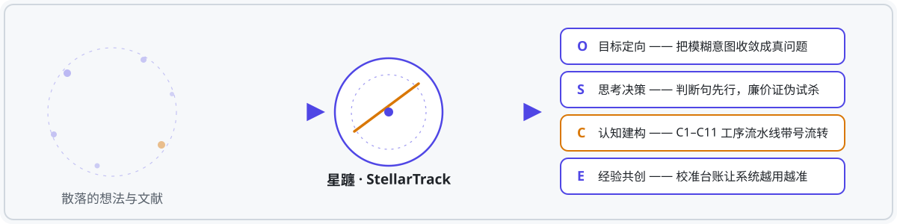

# StellarTrack — A Cross-Genre Academic Writing System

  



> **StellarTrack (星躔, Xīngchán) is an AI academic-writing protocol suite. It does not write papers for you — it breaks "writing a defensible paper" into eleven stations (C1–C11), each with defined deliverables, quality gates, and traceable artifact IDs, so the AI does only what each step requires while you keep the final say at every critical juncture.**

[简体中文](README.zh-CN.md) | **English**

---

## The Problem It Solves

Ask a large model to "write my paper" and it produces something that *looks* like a paper in ten seconds. But you don't dare submit it — because it never walked through your thinking process, so every conclusion feels borrowed.

What's missing is not text. It is **process**: topic selection that survives falsification, literature that gets verified against sources, frameworks that hold up, de-AI-ified prose, citations checked line by line, abstracts that match the body.

StellarTrack's answer is one principle: **change the genre by swapping the payload, never the pipeline.**

## How It Works

| Phase | What it does | Key mechanism |
|---|---|---|
| **O — Orientation** | Converge vague intent into a real research question | Five-step listen-guess-restate loop |
| **S — Strategy** | Thesis sentence first; cheap falsification before drafting | Argument-anchoring card + 7-element gate |
| **C — Construction** | C1–C11 station pipeline | Numbered artifacts, tiered gates, three-layer loading (fixed skeleton / verb translation / registry matrix) |
| **E — Experience** | The system sharpens with use | Calibration ledger + confidence-weighted writeback |

Three standing rules:

1. AI may participate in thinking but cannot replace understanding — every critical decision point halts for the human.
2. Retrieval runs through real channels (native CNKI browser automation); the LLM never fabricates literature.
3. De-AI-flavoring is a station, not a slogan — C7 runs dedicated dual engines.

## Repository Layout

```
skills/
├── paper-factory/        # Core: SKILL.md + six register workflows + references
├── thinking-protocols/   # DiTing cognitive engine: Socratic pipeline + mode cards + S-layer seven cards
├── abstract-checker      # Abstract ↔ body consistency auditor (C11)
├── claim-audit           # Claim-to-source verification
├── manuscript-review     # Pre-submission self-review
├── journal-fit           # Target-journal requirements checker
├── reference-check       # Reference-by-reference verification
├── research-design       # Method design
├── theoretical-framework # Framework construction
├── title-assessor        # Title evaluation
├── cnki-deepsearch       # CNKI search base (own account required)
├── gongwen-draft         # Official-document writing
├── nssfc-* (6 skills)    # National Social Science Fund proposal pipeline
└── …                     # See NOTICE.md for the full provenance list
```

## Environment-Bound Components (not distributable)

| Component | Note |
|---|---|
| C2 CNKI topic channel | Protocol lives in `skills/paper-factory/references/学术档工作流.md`; needs Chrome remote debugging + your own CNKI session |
| C6 tencent-docx typesetting | WorkBuddy built-in plugin; substitute your platform's docx exporter |
| Gongwen fonts | `gongwen-draft/assets/fonts/` excluded for font licensing; install 仿宋_GB2312 / 方正小标宋 yourself |

Private runtime data (preference profiles, traces, calibration ledgers) is not included.

## License & Provenance

See [NOTICE.md](NOTICE.md). Components are listed per-item as original vs third-party-pending-verification; check licenses before using third-party items.

## License

MIT © 2026 Ruojun（duzhihan）
