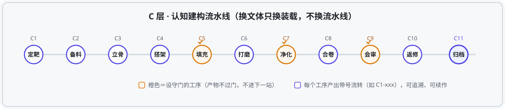

# 星躔 · StellarTrack — 跨场景学术写作系统

  


> **星躔（StellarTrack）是一套 AI 学术写作协议（skill 集）。它不替你写论文——它把"写一篇站得住的论文"拆成 C1 到 C11 十一道工序，每一道有明确的产物、守门和流转编号，让 AI 在每一步只做该做的事，让你在关键处永远握着拍板权。**

**简体中文** | [English](README.md)

---

## 从一个场景说起

凌晨一点，你对着屏幕上第三版开头发呆。

选题是好的，文献读了不少，脑子里也有话想说。可真到了下笔，问题全冒出来了：综述像读书笔记，理论框架撑不起后面的论证，写出来的句子一股"AI 味"，摘要吹的正文接不住……

你把"帮我写篇论文"扔给大模型，它十秒钟给你一篇像模像样的东西。

但你不敢投。因为你知道：**它没有走过你走过的思考过程，所以它的每一个结论你都替它心虚。**

这，就是星躔要解决的、那件具体的事。

---

## 你缺的不是文字，是工序

论文写作不是"一次生成"，是**一条流水线**：选题要测杀、材料要备齐、结构要先立、成稿要打磨、引用要对表、评审要过门。常规做法为什么都差一步：

- **直接让大模型写**：跳过全部工序。产出的是"文章的形状"，不是"论证的结构"。
- **堆一堆提示词**：每个环节都有招，但环节之间不衔接——选题卡和初稿之间隔着一条断头路。
- **模板化写作框架**：给了骨架，但骨架不会随着文体变（期刊论文、会议稿、申报书、公文各是各的规矩）。

星躔的回答是一条原则：**换文体只换装载，不换流水线。**

## 它是怎么工作的



四段架构，各司其职：

| 段 | 干什么 | 关键机制 |
|---|---|---|
| **O 目标定向** | 把模糊意图收敛成真问题 | 五步听猜复述，≤2 轮直通 |
| **S 思考决策** | 判断句先行，先证伪再动工 | 论证锚定卡＋七要素守门 |
| **C 认知建构** | C1–C11 工序流水线 | 产物带号流转＋守门分级＋三层装载（骨架不变层／动词翻译半变层／注册表全变层） |
| **E 经验共创** | 让系统越用越准 | 校准台账＋置信加权回写 |

配套理论文档见 [docs/THEORY.md](docs/THEORY.md)（谛听六环认知引擎的设计原理）；运行时数据模板见 `data/_templates/`。

三条设计铁律贯穿全程：

1. **AI 可参与思考，不能替你理解**——关键拍板点必停，确认必回显。
2. **检索走真实通道**——知网原生界面自动化，LLM 不自建文献（防幻觉）。
3. **去 AI 味是工序不是口号**——C7 净化独立设站，双引擎联检。

## 目录结构

```
skills/
├── paper-factory/        # 星躔本体：SKILL.md＋六档工作流＋references 全套
├── thinking-protocols/   # 谛听 · 认知引擎：苏格拉底管道＋模式卡库＋S 层七卡
├── abstract-checker      # C11 摘要↔正文一致性对照器
├── claim-audit           # 承重主张回源核验
├── manuscript-review     # 交稿前自审
├── journal-fit           # 目标期刊要求对标
├── reference-check       # 参考文献逐笔查核
├── research-design       # 研究方法设计
├── theoretical-framework # 理论框架建构
├── title-assessor        # 标题评估
├── cnki-deepsearch       # 知网检索底座（需自备账号）
├── gongwen-draft         # 规范公文写作
├── nssfc-*（6件）        # 国家社科基金申报全管线
└── …                     # 其余见 NOTICE.md 来源清单
```

## 环境绑定件说明（不在仓库、也无法打包）

| 组件 | 说明 |
|---|---|
| C2 知网选题通道 | 协议全文在 `skills/paper-factory/references/学术档工作流.md`，需 Chrome 远程调试＋本人知网账号会话 |
| C6 排版 tencent-docx 线 | WorkBuddy 平台内置组件；其他平台用各自的 docx 导出方案替代 |
| 公文字体 | `gongwen-draft/assets/fonts/` 因版权未随仓库分发，使用前自行安装仿宋_GB2312、方正小标宋等并放回该目录 |

私有运行时数据（偏好画像、思维轨迹、校准台账等）不入库。

## 许可与来源

见 [NOTICE.md](NOTICE.md)——各子组件分「自研／第三方待核」两档逐项列明，第三方件使用前请自查许可。

## License

MIT © 2026 Ruojun（duzhihan）
