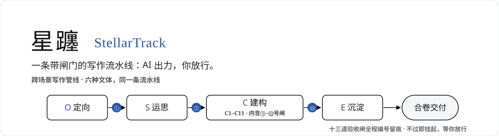
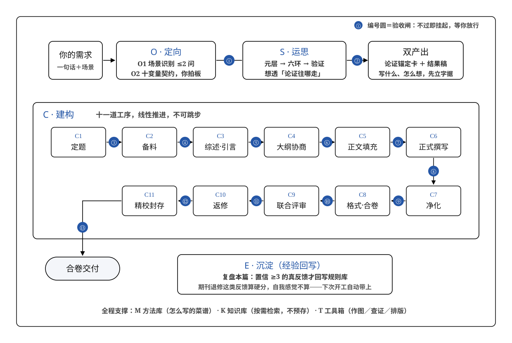

<div align="center">



# 星躔 StellarTrack

**一条带闸门的写作流水线：AI 出力，你放行。**

O 定向 → S 运思 → C 建构（C1–C11） → E 沉淀 ｜ [快速开始](#快速开始) · [60 秒样例](#60-秒看它接一单) · [同类对照](#同类项目对比)

</div>

---

## 我为什么造它

我写论文、标书、公众号长文时，反复撞上同一堵墙：

- 写到一半发现立论没立住，推倒重来；
- 让 AI 代笔，得到“谁都能写出来的平均文本”，撑不过审稿人第一眼；
- 这次改对的坑，下一篇照踩——对话一关，教训清零。

市面上的工具只有两种：帮你润色的，和替你全自动生成的。**前者不管过程，后者抢走思考。**我要第三种：把我的写作流程拆成十一道工序，每道设一道闸门——AI 把检索、初稿、排版这些苦力活干完，但每个关键决定都停下来等我签字。

这就是星躔。它治好了我三个老毛病，也许也是你的：

| 你的老毛病 | 星躔的办法 |
|---|---|
| 流程乱，写到一半推倒重来 | 十一道工序只许顺着走，每道有验收 |
| AI 味洗不掉 | 两道净化关：语义扫描＋规则复检，逐项留痕 |
| 经验留不下，下篇照踩坑 | 每篇结束复盘一次，可信的经验才存进规则库 |

发通知、改邮件？直接问大模型就好，用不上这套。

## 先看证据

不是纸上架构，开发期真稿跑出来的：

| 路径 | 稿件 | 结果 |
|---|---|---|
| 校验后半程 | 论坛投稿论文 3739 字 | 去 AI 味检查全项通过 |
| 校验前半程 | 研究方案 5692 字 | 正确识别早期稿件，不误套后段检查 |
| 全链路 | 长稿 31783 字 | 十一道工序走通，中途真实续写 637 字 |
| 专家团评审 | 现行五席编制 | 六维加权 **8.4/10**，条件通过 |

> 都是开发期自评自测。**还没有任何外部用户检验**——这是实话，也在路线图第一位。

## 60 秒看它接一单

> **我**：帮我写个课程思政教学案例，下周交教务处。
>
> **星躔**：收到——这是规范类·教学场景。只问两件事：①课程名和专业？②思政映射点您定了哪几个？
>
> **我**：《数字媒体艺术概论》，定了三个。
>
> **星躔**：齐了，开工。……走到材料建档了，缺口三项查齐，放行，下一步综述。

它干活时你随时看得见进度：

```
[✓]定向 [✓]运思 [✓]选题 [⏳]材料 [ ]综述 …
▌环节卡▌ 材料建档完成 ｜ 验收通过 ｜ 下一步：综述
```

信息给足了它不废话；该问的最多问两轮，每问都附推荐答案；猜的地方明说“我假设了 X”，随时推翻。

## 什么时候轮到它

不看头衔，看你卡在哪：

| 卡点 | 它接手处 |
|---|---|
| 面对空白页敲不出第一句 | 先问清“要论证什么”，再动笔 |
| 文献读了一摞，说不出别人缺什么 | 三轮检索＋缺口公式，逼成一句话 |
| 初稿越读越不像自己写的 | 净化双道门逐项去 AI 味 |
| 改到第五版分不清好坏 | 每版有编号有分数，比较回到事实 |
| 退修意见几十条砸过来 | 分模式返修：逐段对照／全局诊断各归其位 |
| 上篇的坑这篇又踩一遍 | 规则库里全是上篇攒下的教训 |

一句话：**这份写作值得你想清楚**。

## 快速开始

1. 本仓库放进 Agent Skill 加载目录（WorkBuddy：`~/.workbuddy/skills/xingchan/`）；
2. 新会话说一句“帮我写……”；
3. 在闸门前回来拍板，其余交给它。

## 开放性：骨架开箱即用，引擎按需自配

这套流水线分两层。**骨架层零依赖**——下载即可跑：O 到 E 的工序流转、十三道闸门、编号留痕全在本仓库内，不依赖任何外部工具。

**引擎层按需挂**。每道工序可以接一个专职 skill 干重活（检索、综述、去 AI 味、机制图、评审……每道工序的默认引擎与降级路径，对照表见 `references/C环节skill注册表.md`）：

| 你想要 | 动作 |
|---|---|
| 先跑起来 | 什么都不装——缺引擎时自动走降级路径，骨架照样走完全程 |
| 看缺什么 | `python check-engines.py` 一键体检，输出各工序引擎就绪/缺失报表 |
| 补某道工序的引擎 | 查注册表对应行，安装该 skill 即生效；候选工具登记册见 `references/T工具箱_待加载清单.md` |
| 自带钥匙 | 知网账号、embedding key 等自备；凭据只进环境变量或交互输入，**绝不写入文件与产物** |

**探索与扩展**：

- 教它你的写作方法 → 往 `references/methods/` 写方法卡（六字段制，卡 01/02 是现成样例）；
- 换文体／加档位 → 各档位工作流指令包都在 `references/`（学术、规范、传播、申报、回溯、演讲、创作七套），照抄结构写新档即可；
- 引擎不好用 → 在 `data/graft-log.md` 记一行缺口，同格命中两次自动触发候选搜寻（三步嫁接环：缺口→试挂→转正）；
- 灵感废料 → `data/insight-inbox.md` 暂存箱，月检回流。

## 六档场景，一套管线

论文是母版；其他文体换内容指令，不换流程。讲话稿＝传播档的现场变体。

学术（论文）｜ 申报（标书）｜ 传播（公众号）｜ 规范（公文）｜ 回溯（结题报告）｜ 创作（小说诗歌）

## 怎么运作

四个阶段走完全程：**定向**（听懂你要什么，≤2 问）→ **运思**（想透怎么写，产出论证锚定卡）→ **建构**（C1 到 C11 十一道工序，从选题一路做到精校，共十三道验收闸）→ **沉淀**（复盘本篇，可信的经验存档，下次开工自动带上）。



三样东西贯穿始终：**每份产物有编号版本**，可回退可接力；**每道闸门打分留痕**，六维固定权重；**经验入库要够格**——期刊退修这类真反馈才算硬分，自我感觉不算。

<details>
<summary><b>为什么叫“星躔”</b></summary>

躔（chán），星辰运行的轨迹（《方言》：“日运为躔”）。文章章法如星之轨迹——星躔由此得名：写作即顺天行文，以文迹为轨。**系统部件一律以功能编号命名**（O/S/C/E 四层、C1-C11 工序、守门①-⑬、M/K/T 三库），不用星宿映射——编号即功能，开箱即懂。

</details>

## 同类项目对比

| | 学术辅助工具 | 科研多智能体 | 提示词框架 | 工作流平台 | **星躔** |
|---|---|---|---|---|---|
| 本质 | 润色排版 | 自动化生成 | 输入模板 | 流程节点编排 | **端到端流水线＋质量闸** |
| 短板 | 不管过程 | 抢走思考 | 无过程约束 | 无写作判据 | 社区检验为零 |

对提示词框架：**LangGPT 教你把话说好，星躔管把文章写完**。对自动化平台：Dify 编排 API 节点，星躔编排带验收的认知工序。代价也直说：设计水位高，实战水位尚浅。

## 用之前知道这些

- 进度条出现 `[⏸]` 时回来拍板，你的决定解锁下一步；
- 被打回不是故障，是闸门在工作；
- 外部账号（知网等）自备，密码 token 绝不入库；
- 发现个人信息残留请提 Issue，立即处理。

**路线图**：首个外部用户实测案例 → 英文文档 → 贡献指南。**License**：MIT。
